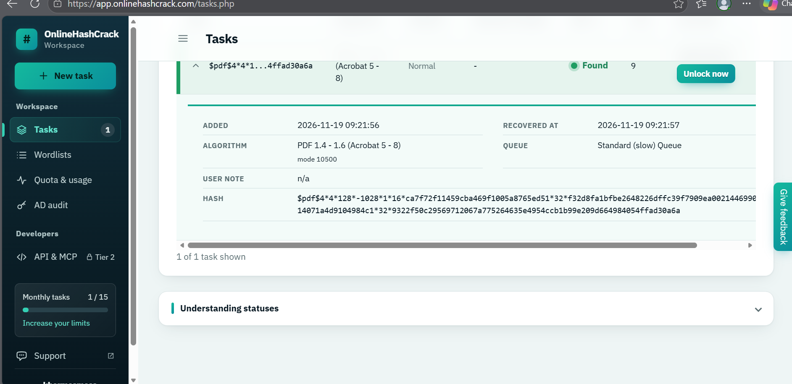
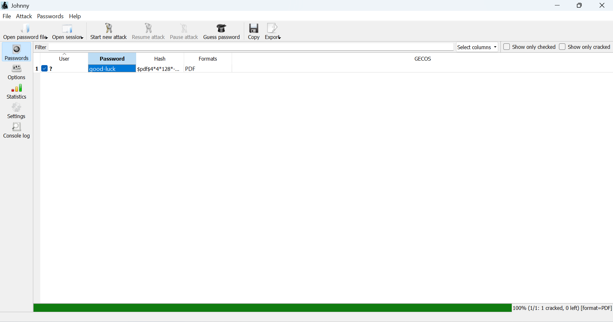
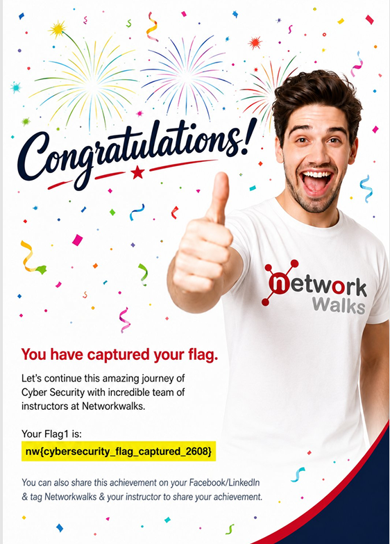
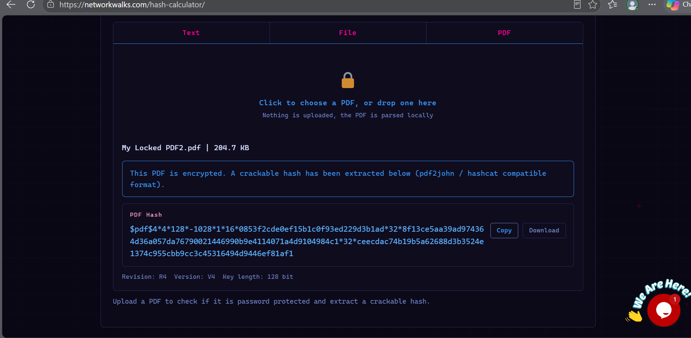
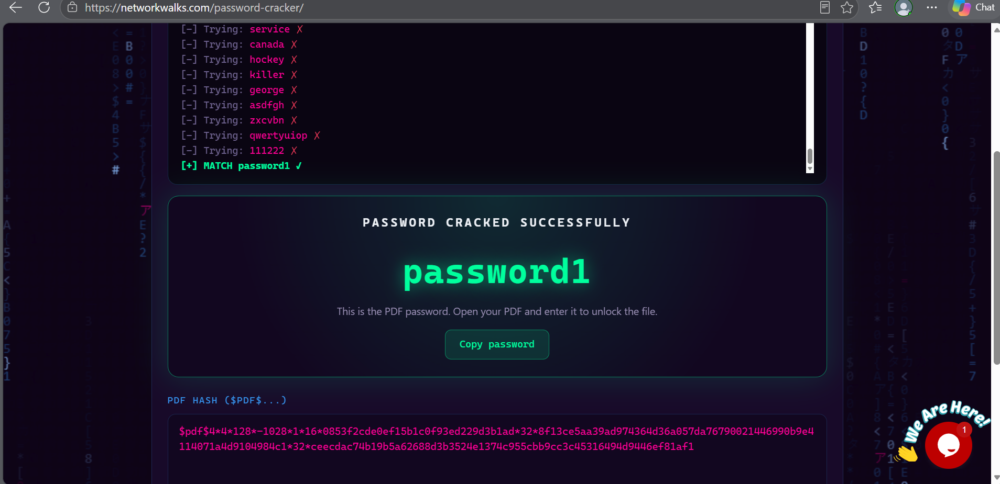
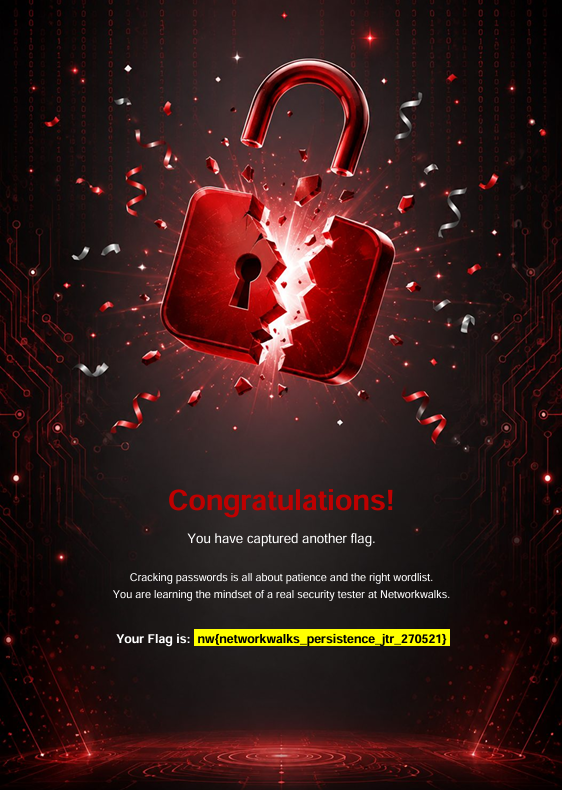

# NetworkWalks Week 3: Password Cracking

**Author:** Khamis Mussa Khamis
**Programme:** NetworkWalks Cybersecurity & Ethical Hacking, Week 3 Project Work
**Environment:** Windows (browser-based tools + John the Ripper / Johnny)
**Purpose:** Education only

---

## 1. Summary

Week 3 is about **password cracking**: understanding how a password-protected file's password is stored as a hash, and how that hash can be attacked to recover the original password. Both essential modules are required, and both are completed here.

| Module | Title | Status |
|---|---|---|
| W3-PM1 | Password cracking with JTR (John the Ripper / Johnny) | Done |
| W3-PM2 | Password cracking with NetworkWalks tools | Done |

I did not attempt the optional modules (AI/Hexstrike JTR lab, Mediroza Hospital portal).

**Note on target files:** the task instructions specify `My Locked PDF1.pdf` for both modules. I used `My Locked PDF1.pdf` for W3-PM1 and `My Locked PDF2.pdf` for W3-PM2, with my instructor's permission. Both locked PDFs are included in `source-files/` for reference.

## 2. Scope and rules I followed

- Only the two PDF files supplied for this lab (`My Locked PDF1.pdf` and `My Locked PDF2.pdf`) were attacked. No other files, accounts or systems were targeted.
- All cracking was done with the tools specified in the lab (John the Ripper / Johnny, and the NetworkWalks Hash Calculator / Password Cracker web tools), for learning purposes only.
- Cracked passwords are reported here only because they belong to practice files created for this course, not to a real system.

## 3. Repository structure

```
.
├── README.md                 <- this report
├── PM1-jtr/                  <- John the Ripper / Johnny screenshots + extracted hash
├── PM2-nw-tools/              <- NetworkWalks Hash Calculator / Password Cracker screenshots
└── source-files/              <- the two locked PDF files used in the lab
```

---

## 4. W3-PM1: Password cracking with JTR (John & Johnny)

**Target file:** `My Locked PDF1.pdf`
**Tools:** [OnlineHashCrack PDF Hash Extractor](https://www.onlinehashcrack.com/tools-pdf-hash-extractor.php), John the Ripper (Johnny GUI)

### Step 1: Extract the hash

I uploaded `My Locked PDF1.pdf` to the online PDF hash extractor, which read the file and produced a crackable hash in the `$pdf$...` format used by John the Ripper.

Extracted hash (saved as `hash1.txt`):

```
$pdf$4*4*128*-1028*1*16*ca7f72f11459cba469f1005a8765ed51*32*f32d8fa1bfbe2648226dffc39f7909ea0021446990b9e4114071a4d9104984c1*32*9322f50c29569712067a775264635e4954ccb1b99e209d664984054ffad30a6a
```



Raw hash file: [hash1.txt](PM1-jtr/hash1.txt)

### Step 2: Crack the hash with Johnny

I installed John the Ripper and the Johnny GUI, pointed Johnny to `john.exe`, opened `hash1.txt` as the password file, and started a new attack.

**Result:** the password was recovered as **`good-luck`** (100% complete, 1 of 1 hash cracked, format = PDF).



I then opened `My Locked PDF1.pdf` using `good-luck` as the password and confirmed it unlocked successfully, which captured the lab flag:

```
nw{cybersecurity_flag_captured_2608}
```



---

## 5. W3-PM2: Password cracking with NetworkWalks tools

**Target file:** `My Locked PDF2.pdf` (used in place of PDF1, with instructor's permission)
**Tools:** [NetworkWalks Hash Calculator](https://networkwalks.com/hash-calculator/), [NetworkWalks Password Cracker](https://networkwalks.com/password-cracker/)

### Step 1: Extract the hash

I uploaded `My Locked PDF2.pdf` to the NetworkWalks Hash Calculator (PDF tab). It confirmed the file is encrypted (Revision R4, Version V4, 128-bit key) and produced a crackable hash:

```
$pdf$4*4*128*-1028*1*16*0853f2cde0ef15b1c0f93ed229d3b1ad*32*8f13ce5aa39ad97436d36a057da767900214460990b9e4114071a4d9104984c1*32*ceecdac74b19b5a62688d3b3524e1374c955cbb9cc3c4531649d9446ef81af1
```



### Step 2: Crack the hash with the Password Cracker

I pasted the hash into the NetworkWalks Password Cracker and started the attack. It tried a series of common passwords (`service`, `canada`, `hockey`, `killer`, `george`, `asdfgh`, `qwertyuiop`, `111322`, ...) until it found a match.

**Result:** **MATCH** — the password was cracked successfully as **`password1`**.



I opened `My Locked PDF2.pdf` with `password1` and confirmed it unlocked, which captured the lab flag:

```
nw{networkwalks_persistence_jtr_270521}
```



---

## 6. Comparison: JTR vs NetworkWalks tools

| | W3-PM1 (JTR/Johnny) | W3-PM2 (NetworkWalks tools) |
|---|---|---|
| Installation needed | Yes (John the Ripper + Johnny) | No — runs in any browser |
| Hash extraction | Third-party website (OnlineHashCrack) | NetworkWalks Hash Calculator |
| Cracking method | Local offline attack (wordlist/incremental) | Online dictionary attack |
| Password recovered | `good-luck` | `password1` |
| Best for | Full control, works offline, supports many hash/file types | Quick checks, no setup, good for beginners |

## 7. Findings and recommendations

- Both passwords (`good-luck`, `password1`) are **dictionary words with no complexity** (no mix of case, numbers and symbols beyond a simple pattern), which is why both tools cracked them in a short time.
- This confirms why common or short passwords are unsafe: once a password hash is exposed, a dictionary attack can recover it quickly.

**Recommendations:**

1. Use long, random passphrases rather than single dictionary words, even with a hyphen or number added.
2. Avoid reusing passwords across personal and work files.
3. For files that must be shared, prefer strong, randomly generated passwords sent through a separate secure channel rather than predictable words.

## 8. Conclusion

This week showed, hands-on, how a password-protected PDF's hash can be extracted and then cracked — first with an installed tool (John the Ripper/Johnny), then with simple browser-based tools (NetworkWalks Hash Calculator and Password Cracker). Both approaches recovered the password quickly because the passwords used were weak, which is the main lesson of the lab: 
password strength, not just the existence of a password, determines how protected a file really is.

## 9. Tools used

OnlineHashCrack (PDF Hash Extractor), John the Ripper, Johnny GUI, NetworkWalks Hash Calculator, NetworkWalks Password Cracker.

*Educational use only. Passwords were cracked only for practice files provided for this course, with instructor permission.*

## 10. LinkedIn post

A short post sharing this Week 3 password cracking lab (W3-PM1 & W3-PM2):

🔗 [View my LinkedIn post](https://lnkd.in/p/dRwQXYrG)
